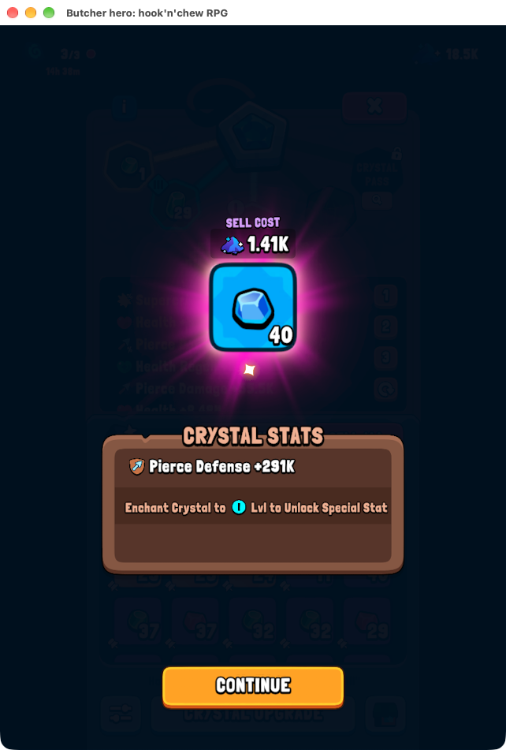

# Kristálynyitás és visszatérés a Free-gyűjtéshez — 2026-10-31

## Kérés és hatókör

A felhasználó négy képpel megadta és engedélyezte: piros pontos kék
kristályikon → főpanel x1Open → kristály többszöri ütése → Continue →
főpanel jobb felső pirosX. Nem számít a kristály színe/szintje. Ez felülírja
312 előjegyzett státuszát, de nem enged SellAllt, fejlesztést, felszerelést,
reklámot vagy pénz/gemköltést. A régi mozgó/harcoló bot és heartbeat PAUSED.

## Felismerés és vezérlés

- HUD: a jobb oldali meghatározott régióban piros jel+fehér szegély és
  alatta kék kristálypixelsáv, két friss megfigyelés. Térképes piros pont nem cél.
- Főpanel: CRYSTAL STATS + CRYSTALS + saját felső pirosX. Az aktív nyitás
  arany gomb és felismert x1; a letiltott Open külön szürke+OPEN állapot.
  A stylizált0/9-et az OCR0/S-nek is olvassa, ebből nem találunk ki számlálót.
- Kezdeti geode: BLACKSMITHING + TAP TO OPEN GEODE és a megfelelő panel.
- **Új élő köztes állapot:** első ütés után nincs barna lap és felsőX;
  nagy lila kő + TAP TO OPEN GEODE marad. Ez is geode, nem ismeretlen modal.
- Eredmény: CRYSTAL STATS + arany CONTINUE, független a változó kristálytól.
- Continue után a főpanel sajátX-e zár. Két friss HUD után egyszer lezárt
  kristálytranzakció; önmagában eltűnt kép vagy elküldött kattintás nem siker.

A relatív koordináták kizárólag az előtte felismert, azonos játékablakban
érvényesek. Aktiválás után új képen újra ellenőrizzük az adott művelet
képernyőfeltételét és a kézi egér/STOP állapotot. Minden ütés előtt is
új kép kell: nincsen a Continue-ra átnyúló vak kattintássor.

A CrystalFlow tiszta állapotgép; következő fázis csak az előző ténylegesen
elküldött művelete után. Lépésenként3kattintás, legfeljebb16ütés,90s teljes
keret. Ismeretlen képernyőn nincs input; lejárt keret blokkol, nem nyom
ismeretlenX-et. Kézi HUD-visszatérés oldhatja a blokkot,60s kristálycooldownnal.
Kezdeti üres panel bezárható, de nem könyvelünk kristályt. Ha Continue után
további geode elérhető, akkor is előbb HUD-ra lépünk; új jelzés új kört indíthat.

Egyetlen watchkör/inputgazda marad. Függő Freeclaim igazolása megelőzi az
új kristálykört; kristály közben a régi Freejelölt törlődik, nincs párhuzamos
kattintás. Visszatéréskor frissFreejelölt kell. A program és a felügyelet a
modal alatt is fut, lastCheckedAt frissül; nincs külön második bot.

## Napló és helyreállítás

`data/crystal-rewards/events.jsonl` külön append-only folyamatnapló,
`data/crystal-rewards/evidence/` eredeti teljes képek. Események:
crystal_started, crystal_screen, crystal_click_validated/sent/rejected,
crystal_blocked, crystal_operator_recovered, crystal_completed_ui.
Teljes eredmény nélkül visszatért HUD: crystal_finished_no_reward,0jutalom.
A fő state.json crystalPhase mezője az aktuális fázist adja. A kristály
nem kerül a Freejutalomnaplóba vagy a8stat összegeibe; a kristályon szereplő
stat nem azonos azonnali karakterstat-nyereséggel. Eredmény-OCR/új dashboard
nem része ennek a kérésnek; a teljes eredményPNG megmarad későbbi elemzésre.

Normál workerrestart nem veszi át a felhasználó nyitott paneljét. Felügyelt
hibajavítás utáni egyszeri folytatás: `scripts/start-free-rewards.sh --resume-run
--recover-crystal`. Csak10percen belül megkezdett saját, le nem zárt tranzakció
elküldött lépéseiből állhat helyre; a próbák száma nem nullázódik, minden
inputhoz új képi ellenőrzés kell. A felügyelő a kapcsolót csak első indulásra
adja át, automatikus újraindításra nem, így timeoutot nem kerül meg végtelenül.
Ez operatoreszköz, nem általános modalfelderítő vagy automatikus restartígéret.

## Képi regresszió

A `tests/RewardAutomationCoreTests/CrystalTests.swift` rögzített vizuális
címkékkel ellenőrzi a `references/2026-10-31/crystals/` eredeti képeit.
Négy felhasználói képernyő, korábbi HUDjelzés és friss élő HUD igen/nem,
kezdeti+repedt geode, élő főpanel aktív/szürke, eltérő kék eredmény.
A címkék emberi képi ellenőrzések, nem automatikusan a felismerő kimenetei.
Az új élő képek a felhasználói minták mellett külön ellenőrzések. A köztes
repedt kép most kalibráció+regresszió, nem független validáció; későbbi
eltérő repedt képpel bővítendő. A szín/szint nem kap beégetett értéket.

Állapotsortesztek: teljes sorrend, két értesítéses kép, kézi húzás/függőFree,
out-of-order/unknown, próbakeret és időzítés, eredmény előtti tiltás,
üres panel nem jutalom, bezárás+HUD előtti tiltás, egyszeri könyvelés,
kézi modal nem automatikus cél, saját-naplós helyreállítás próbakerete.
A meglévő negatívFree-modalképek sem válhatnak kristálycéllá. A közös
`make test`, commit/push/PR-kapu ezeket is futtatja, az elvárt címkék
megváltoztatása helyett a hibás felismerést kell javítani.
Jelenleg12valódi kristályminta,13CrystalTests; a felügyelő új tesztje két
hamisított workerrel bizonyítja, hogy --recover-crystal csak az első
indulásra kerül át, a következő automatikusrestartnak már nem adjuk át.

## Élő kísérlet — tények, nem megszakításmentes sikerígéret

09:18:49Zelőre fordított újworker48660. Tranzakció:
`0D44E692-AA12-495A-9156-0E859077821D`. HUDjelből főpanel, x1, elsőgeodeütés.
A barna lap eltűnt, a repedt kő hiányzott a felismerésből; ezért nem volt
továbbiinput,09:20:21Ztimeout. Köztesképet értelmeztük, külön ág+teszt készült.

09:21:44Zworker49939 egyszeri --recover-crystal folytatással;09:21:50/52Z
két továbbiütés;54Zeredmény ésContinue;57ZX;59ZkétHUD és completed_ui.
Eredmény: **kék40, PierceDefense+291K**, SellCost1.41K. Az eladási érték
csak képi felirat, eladás és felszerelés nem történt. A következőFree:
09:22:19Zkattintás,21Zigazolt+581CutDefense. Ez bizonyítja a visszaadást.

Az első kör javítás miatt megszakadt: nem nevezzük teljesen önálló,
elejétől végéig zavartalan menetnek. A javított verzió új teljes körét és
további képarányokat később élőben ellenőrizni kell; a meglévő folyamat
közben marad futva. Állapotot mindig friss state.jsonból olvasunk.

Végső betöltés09:29:05Z: worker52120, supervisor52048, tartóssession91902,
--resume-run (nem új statfutás).09:29:23ZújHealth18100UIigazolás az újbuilddel.
42Swift (ebből13Crystal),16Pythonstats,3Gitkapu,10felügyeleti,31Node:
**102teszt és7JSszintaxisellenőrzés helyben PASS**. Acommit/push kapu a
pontosindexet/committree-t ismét ellenőrzi; aGitHubCI ettől külön eredmény.
